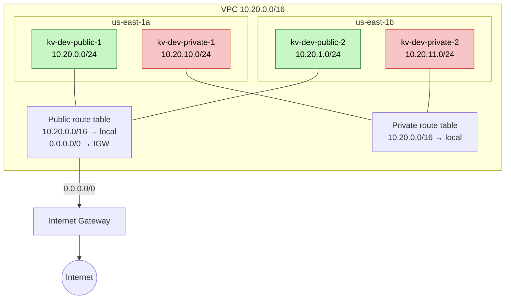

# Capstone

A light DynamoDB-like key-value store capstone for Cloud Architectures 2026/27. Infrastructure is CloudFormation, deployed into the AWS Academy sandbox.

## Prerequisites

1. AWS Academy: Cloud Architecting course, Sandbox Environment. Click Start Lab, open AWS Details, copy the AWS CLI block and paste the block into `~/.aws/credentials`. The credentials rotate every session; never commit them.
2. AWS CLI v2 and `jq` on the PATH.
3. Python virtualenv with the template tools: `python3 -m venv .venv && .venv/bin/pip install cfn-lint cfn-flip`. Run it in the repository root; the scripts call `.venv/bin/cfn-lint` and `.venv/bin/cfn-flip` directly.
4. Region is `us-east-1`, set in `scripts/env.sh`; the scripts need no other configuration.

A sandbox session lasts 3 hours, and project resources do not survive the end of a session: after End Lab and a new Start Lab, `kv-network` was gone (`docs/sandbox.md`, run 2026-11-12T20:25:23Z). Run the deploy below at the start of every session.

## Bring it up

```sh
scripts/deploy-network.sh <Owner>
```

Creates or updates the `kv-network` stack from `infra/network.yaml`, tagged `Project=capstone-kv`, `Milestone=m1`, `Owner=<Owner>`. Re-running it on an existing stack is a no-op.

## Verify

```sh
scripts/verify-network.sh   # 11 checks, expect 11 PASS
scripts/verify-iam.sh       # lints infra/iam.yaml and checks it against the IAM policy simulator, expect all PASS
```

## Network

VPC, subnets and routing: see [docs/network.md](docs/network.md).



## Access

Read-only access is defined in `infra/iam.yaml`: the `ReadOnlyPolicy` policy and the `ReadOnlyRole` role, which the principal passed as the `TrustedPrincipalArn` parameter can assume. The sandbox deploy attempt passed `arn:aws:iam::<account>:root`, which means "the account": any principal in it whose own identity policy allows `sts:AssumeRole` on this role can take it; for "exactly one principal" pass a specific role ARN. A reviewer calls `sts:AssumeRole` and gets temporary credentials with view rights (network, project stacks, bucket metadata, alarms and the metric list, quotas) and no writes and no object contents; this beats a user group because the credentials expire instead of staying as permanent membership. The sandbox did not allow this stack to be created (`iam:CreatePolicy` is denied); details and the exact refusal text: [docs/labrole.md](docs/labrole.md#deploying-kv-iam).

## What changed in M1

- Network stack `kv-network`: one VPC, two public and two private subnets, see [docs/network.md](docs/network.md) and [infra/network.yaml](infra/network.yaml).
- Read-only IAM template [infra/iam.yaml](infra/iam.yaml); it cannot be deployed in the sandbox, see [docs/labrole.md](docs/labrole.md).
- Sandbox limits and facts (session length, credit ceiling, allowed regions): [docs/sandbox.md](docs/sandbox.md).
- Quotas and the M2 budget estimate: [docs/quotas.md](docs/quotas.md), [docs/budget.md](docs/budget.md).
- Recreatability proof (delete, create, verify; drift check): [docs/recreate-log.md](docs/recreate-log.md), raw output in [docs/evidence](docs/evidence).
- Architecture decisions: [ADR-0001 access control](docs/adr/0001-access-control-model.md), [ADR-0002 IaC tool](docs/adr/0002-iac-tool.md), [ADR-0003 stack layout](docs/adr/0003-stack-layout.md), [ADR-0004 CIDR scheme](docs/adr/0004-cidr-scheme.md).
- OpenSpec change with proposal, design, specs and tasks: [openspec/changes/m1-infrastructure-setup](openspec/changes/m1-infrastructure-setup).
