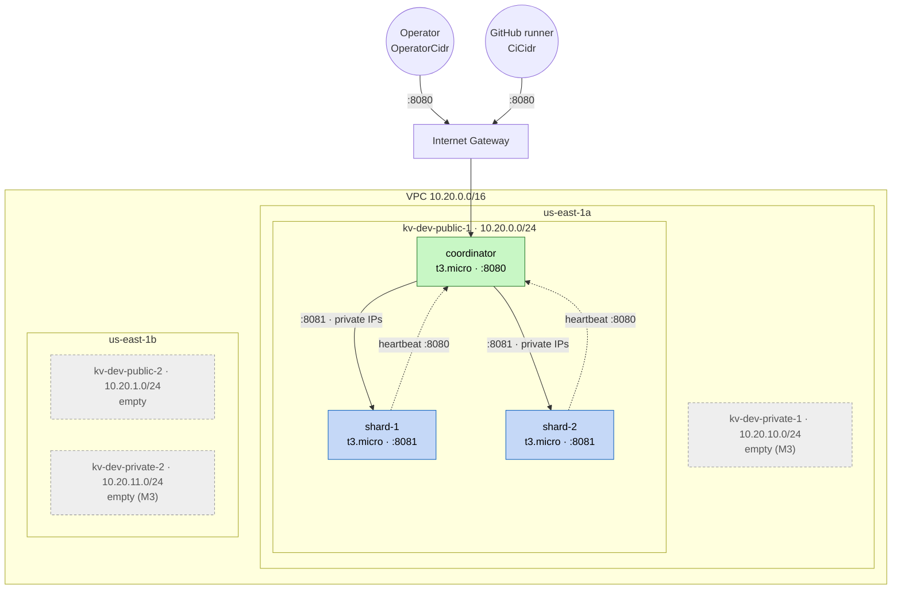

# M2 architecture

Coordinator and 2 shards in one AZ, public subnet. Decision and reasons: [ADR-0008](../adr/0008-compute-and-exposure.md).

## Who can talk to whom

| To | Port | Allowed from |
|---|---|---|
| coordinator | 8080 | `OperatorCidr`, `CiCidr`, shard SG (heartbeat) |
| shard-1, shard-2 | 8081 | coordinator SG only |

## Why one AZ

- Benchmark has no cross-AZ latency or transfer cost.
- Cost: if `us-east-1a` fails, everything fails. Acceptable in M2: data is in memory anyway.
- M3 spreads shard replicas over both AZs.
