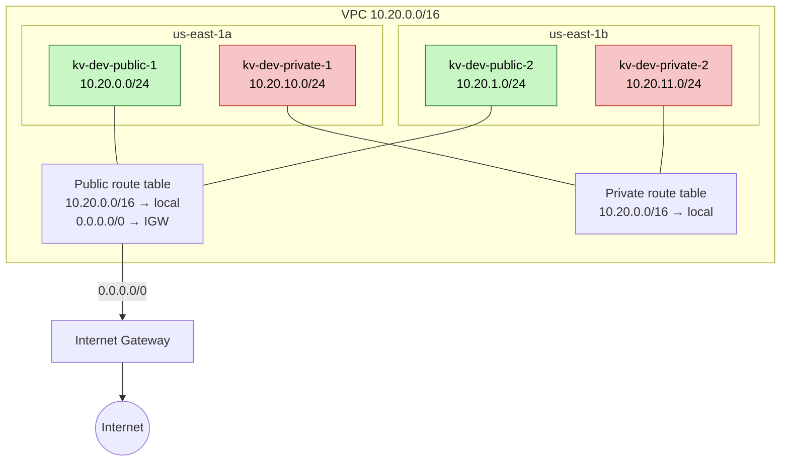

# Network

Public-підмережі (зелені) мають маршрут `0.0.0.0/0` через Internet Gateway, тому ресурси в них можуть виходити в інтернет. Private-підмережі (червоні) мають лише локальний маршрут `10.20.0.0/16 → local`: вони не мають доступу до інтернету і недосяжні ззовні. NAT Gateway свідомо не створюється: він платний, а ресурсам у private-підмережах зовнішній доступ не потрібен (див. [ADR-0004](adr/0004-cidr-scheme.md)).

